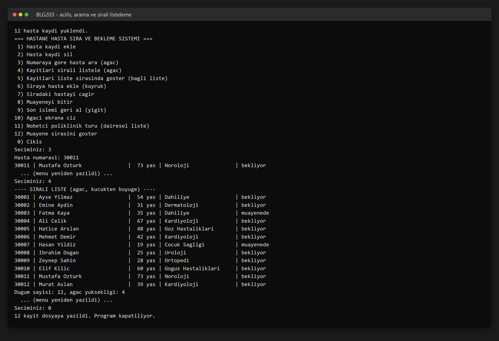
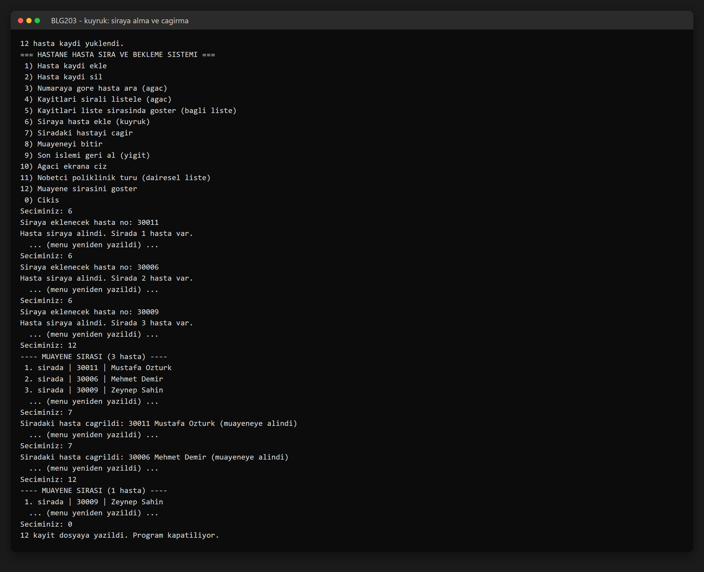
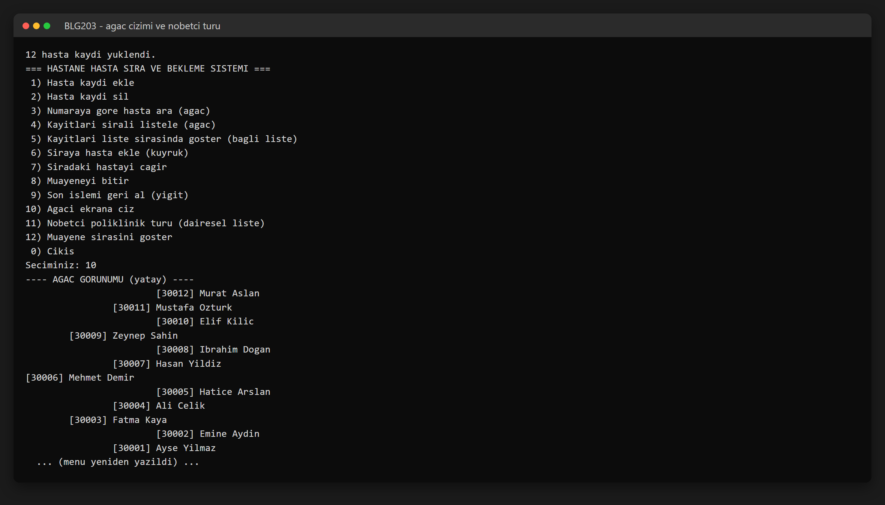

# Hastane Hasta Sıra ve Bekleme Sistemi

BLG203 Veri Yapıları, dönem projesi
Cengiz Kılıç, 251205027
İstanbul Rumeli Üniversitesi, Yapay Zekâ ve Makine Öğrenmesi

C11 ile yazılmış, konsol tabanlı hasta kayıt ve muayene sırası uygulaması.
Harici kütüphane yok, derleme tek komut.

**Depo:** https://github.com/gecekargosu/blg203-hastane-sira

## Ekran görüntüleri

Açılış, numaraya göre arama ve ağaç üzerinden sıralı listeleme:



Üç hastanın muayene sırasına alınması ve ilk gelen ilk çıkar sırasıyla çağrılması:



Ağacın ekrana yatay çizimi ve dairesel poliklinik turu:



## Durum

| Aşama | Tarih | Durum |
|---|---|---|
| Ara teslim (rapor, UML, kaynak kod, ölçüm) | 22 Kasım 2026 | Tamamlandı |
| Final teslimi | 18 Aralık 2026 | Devam ediyor |
| Sunum | 22 Aralık 2026 | Bekliyor |

## Veri yapıları

| Yapı | Kullanım yeri | Dosya |
|---|---|---|
| Tek yönlü bağlı liste | hasta kayıt defteri | `kaynak_kod/hasta.c` |
| Kuyruk (FIFO) | muayene bekleme sırası | `kaynak_kod/kuyruk.c` |
| İkili arama ağacı | numaraya göre arama, sıralı listeleme, çizim | `kaynak_kod/agac.c` |
| Yığıt | son işlemi geri alma | `kaynak_kod/yigit.c` |
| Dairesel bağlı liste | nöbetçi poliklinik turu | `kaynak_kod/dairesel.c` |
| Dosya işlemleri | CSV okuma ve yazma | `kaynak_kod/dosya.c` |

## Derleme ve çalıştırma

```
gcc -std=c11 -Wall -Wextra -O2 -o hastane.exe kaynak_kod/*.c
hastane.exe                         1200 kayıtlık veri ile açılır
hastane.exe veri/demo_hastalar.csv  12 kayıtlık demo verisi
hastane.exe --benchmark             deneysel ölçümü çalıştırır
```

Derleme uyarı üretmez (gcc 16.2.0, MinGW-W64). Program veri dosyasını çalışma
dizinine göre arar, bu nedenle proje kök dizininden çalıştırılmalıdır.

## Klasör yapısı

```
Rapor.pdf      ara rapor, 15 sayfa
UML.pdf        yapı, modül ve bağımlılık diyagramı
README.txt     kullanım kılavuzu (paket içi sürüm)
kaynak_kod/    13 dosya, 7 .c ve 6 .h
veri/          hastalar.csv (1200), demo_hastalar.csv (12), veri_uret.py
03_Olcum/      benchmark.csv, --benchmark kipinde yazılır
00_Kapak/      üreteç betikleri, ekran görüntüleri ve logo (pakete girmez)
```

## Ölçüm

`--benchmark` kipi 1000, 10 000 ve 100 000 kayıtta ekleme ve arama süresini ölçer,
ağacın yüksekliğini de yazar ve sonucu `03_Olcum/benchmark.csv` dosyasına kaydeder. Kayıt sayısı arttıkça ağaçtaki
karşılaştırma sayısı artar. Aynı ölçüm kuyruk için yapılmaz, çünkü kuyrukta
ekleme ve çağırma sabit zamanda tamamlanır.

## Notlar

- Kaynak dosyalar ASCII tutuldu, belgeler tam Türkçe karakter kullanır.
- Ağaç dengeli değildir (AVL yok). Bu, raporun sınırlar bölümünde yazılıdır.
- Yapay zekâ kullanımı raporun 11. bölümünde açıklanmıştır.
